# Arquitetura — Rede Alimenta IA

> Reflete o que existe no repositório na Fase 4 · Etapa A (conferido em `api/`, `match/`, `database/`, `app/`, `routing/`, `pipelines/`, `simulation/`, `docker/`, `render.yaml`). Diagramas em Mermaid (ver a nota de validação no fim do arquivo). Complementos: [`data-flow.md`](data-flow.md) (fluxo de dados e do match) e [`deployment.md`](deployment.md) (implantação e fronteiras de confiança).

## 1. Visão em camadas (dados → IA → API → interface)

```mermaid
flowchart LR
    subgraph FONTES["Fontes de dados"]
        P1["Fontes públicas REAIS<br/>IPEA/OSC, RBBA, IBGE, PAA"]
        SIM["Simulador<br/>simulation/ (semente + versão)"]
    end

    subgraph ETL["Preparo (pipelines/ e database/importers.py)"]
        PIPE["pipelines: RAW → BRONZE → SILVER → GOLD<br/>(checksums SHA-256 do RAW)"]
        IMP["Importação para o banco<br/>bootstrap_db / load_to_cloud<br/>data_origin preservado"]
    end

    DB[("PostgreSQL<br/>Supabase em produção<br/>RLS em todas as tabelas")]

    subgraph MOTOR["Motor de match (match/)"]
        IDX["Índice espacial de ONGs<br/>(em memória, BallTree haversine)"]
        REG["Regras eliminatórias<br/>(declarado das ONGs)"]
        ML["Ranker ML (HGB)<br/>+ parser semântico"]
        DIST["Score de regras<br/>+ score de distância"]
        FIN["FINAL = 0,5·ML + 0,3·REGRAS + 0,2·DIST"]
    end

    subgraph API["FastAPI (api/)"]
        AUTH["Autenticação Bearer<br/>perfis DONOR, ORG, ADMIN"]
        VIS["Visão por perfil<br/>(response_model)"]
        ROT["Rotas de coleta<br/>OR-Tools + baseline"]
        AUD["Auditoria (audit_logs)"]
    end

    UI["Streamlit (app/)<br/>chama a API pelo servidor"]
    USR(["Usuários: doador, ONG, ADMIN"])

    P1 --> PIPE --> IMP
    SIM --> IMP
    IMP --> DB
    DB --> IDX
    IDX --> REG --> ML --> DIST --> FIN
    FIN --> API
    DB <--> API
    AUTH --> VIS
    API --> UI --> USR
```

**Leitura:** dados públicos e simulados só se encontram no banco/GOLD, sempre com `data_origin` (PUBLIC | SIMULATED | USER_ENTERED) e, nos simulados, `generator_version`, `seed` e `dataset_version` (restrições `CHECK` no banco). O motor lê o perfil das ONGs do banco para um índice em memória (carregado no início da API) e carrega os artefatos do modelo (`ml/artifacts/`, com verificação de hash SHA-256).

## 2. Componentes e responsabilidades

| Camada | Pasta | O que faz | Observações |
|---|---|---|---|
| Ingestão | `pipelines/` | Baixa e transforma fontes públicas (RAW → BRONZE → SILVER → GOLD), com manifesto e checksums | Fora das imagens de produção; `data/` fora do Git |
| Simulação | `simulation/` | Gera doadores, lotes, textos e desfechos **SIMULADOS** (reprodutível por semente) | Rótulo `SIMULATED` em toda linha |
| Banco | `database/` | Modelos SQLAlchemy, migrations Alembic (`0001`–`0005`), importadores | RLS (`0004`), expiração de token (`0005`) |
| IA | `ml/` | Dataset de pares, treino do ranker, parser semântico, artefatos | Métricas **só sobre dados simulados** |
| Motor | `match/` | Elegibilidade, scores, ciclo de vida da proposta, atribuição em lote | Reserva de capacidade em transação (`SELECT … FOR UPDATE`) |
| Rotas | `routing/` | Roteirização da coleta (OR-Tools × vizinho mais próximo) | Distâncias **estimadas**, não viárias |
| API | `api/` | Endpoints `/api/v1`, autenticação, autorização por perfil e por posse, auditoria, dashboard do ADMIN | `/docs` desligado em produção; contrato em `docs/openapi.json` |
| Interface | `app/` | Telas por perfil e dashboard do ADMIN; **só apresenta** (a barreira de segurança é a API) | Chama a API a partir do servidor do Streamlit |
| Segurança | `core/`, `security/` | Cabeçalhos, CORS, limite de tentativas inválidas, rate limit global, logs, STRIDE, relatórios | `core/hardening.py` |
| Infra | `docker/`, `render.yaml`, `.github/workflows/ci.yml` | Imagens, Blueprint do Render, CI | Detalhes em [`deployment.md`](deployment.md) |

## 3. Decisões de projeto relevantes

* **Visibilidade por perfil na API, não na tela.** DONOR recebe só a situação e a ONG que aceitou; ORG recebe a proposta e uma análise textual; scores, ranking e saída do parser são do ADMIN (`docs/ROLE_VISIBILITY.md`, teste `tests/test_p4a_openapi.py`).
* **Humano no circuito.** Itens vindos do texto são sugestões a confirmar; a ONG aceita ou recusa; o sistema nunca atesta segurança do alimento.
* **Processo único para a API.** A expiração de propostas roda como tarefa em segundo plano dentro do processo da API (sem fila externa); o índice de ONGs e o limitador de tentativas vivem em memória **por instância**. Ao escalar para mais de uma instância seria preciso um armazenamento compartilhado (ex.: Redis) ou um gateway.
* **Supabase só como PostgreSQL.** A única porta de entrada dos dados é a API; RLS ligado e papéis `anon`/`authenticated` sem acesso.

## 4. Fora do escopo desta arquitetura

Beneficiário final, pagamentos, notificações externas, filas, cache distribuído, WAF, backup gerenciado e SSO/OIDC **não existem** hoje.

## 5. Validação dos diagramas

Ver a seção "Validação dos diagramas Mermaid" ao final de [`deployment.md`](deployment.md).
