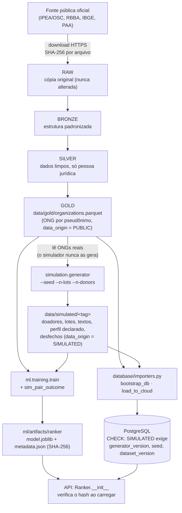
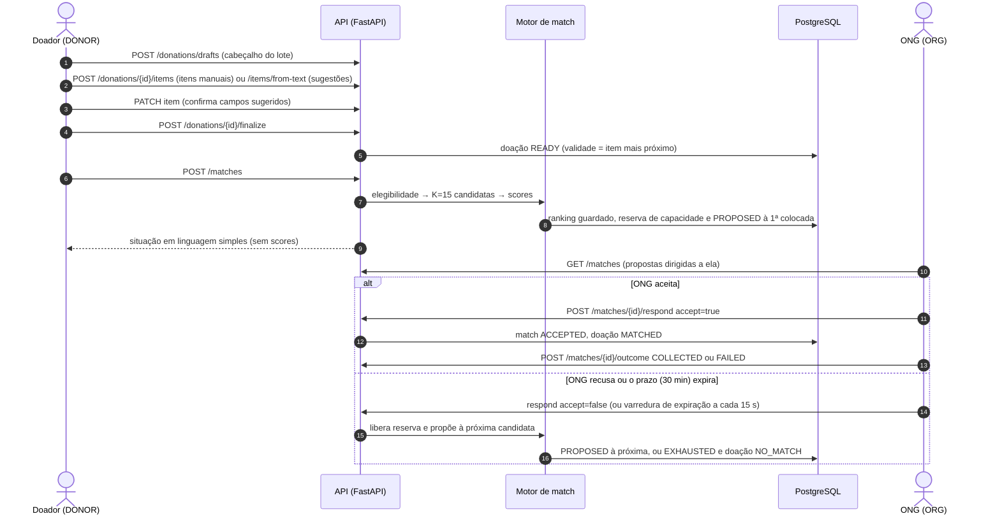
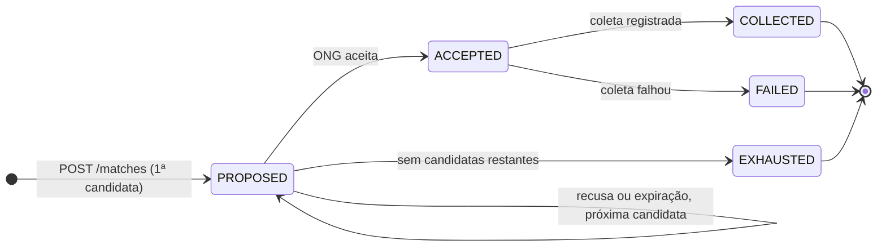
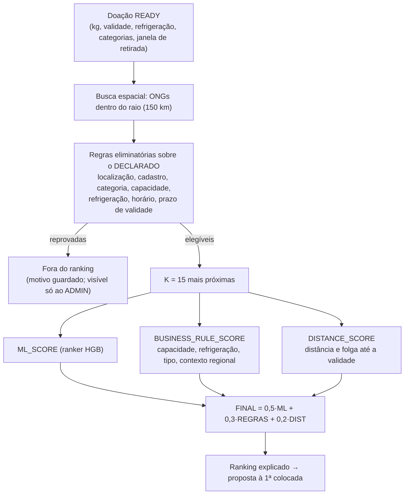

# Fluxo de dados — Rede Alimenta IA

> Conferido em `pipelines/`, `simulation/`, `database/importers.py`, `api/routers/drafts.py`, `match/lifecycle.py`, `match/engine.py`, `docs/FASE2_P1_MATCH_ENGINE.md`.

## 1. Da fonte ao banco (rastreabilidade)

Regras que o desenho impõe: dados reais nunca são inventados ou gerados; dados simulados ficam separados até o GOLD/banco e **sempre** com `data_origin`; o modelo é treinado com rótulos **simulados** (circularidade registrada em `docs/MODEL_CARD.md`).

## 2. Fluxo DOADOR → ONG (estados da doação e do match)

### 2.1 Estados

* Estados do match (`ck_match_status`): `PROPOSED`, `ACCEPTED`, `COLLECTED`, `FAILED`, `EXHAUSTED`. Eventos (`match_events`): `RANKED`, `PROPOSED`, `ACCEPTED`, `DECLINED`, `EXPIRED`, `SKIPPED`, `EXHAUSTED`, `COLLECTED`, `FAILED`, cada um com ator, ONG, posição e carimbo de tempo.
* Estados da doação (`ck_donation_status`): `DRAFT`, `PENDING_CONFIRMATION`, `READY`, `BLOCKED_EXPIRED`, `BLOCKED_NO_VALIDITY`, `MATCHING`, `MATCHED`, `NO_MATCH`, `HISTORICAL` (histórico simulado). `FAILED` devolve a doação a `READY`; `EXHAUSTED` leva a `NO_MATCH`.
* Uma candidata cujas regras deixam de valer no momento da proposta é **pulada** (`SKIPPED`), com reavaliação das regras eliminatórias.

## 3. Dentro do motor (uma requisição de match)

Pesos e premissas são **premissas da equipe, não calibradas com dados reais** (`docs/FASE2_P1_MATCH_ENGINE.md`). A distância é em linha reta (haversine), **não** rota viária; para 99,65% das ONGs a coordenada é o centroide do município.

## 4. Quem vê o quê

| Perfil | Vê | Não vê |
|---|---|---|
| DONOR | situação da doação e do match; ONG (pseudônimo) **só após o aceite** | scores, ranking, elegibilidade, saída do parser |
| ORG | a doação proposta, a própria distância e a "Análise da IA" em texto | scores, posição, outras ONGs |
| ADMIN | tudo (ranking, scores, modelo, parser), com `admin.access` auditado | — |

Detalhes e testes: `docs/ROLE_VISIBILITY.md`.

## 5. Validação dos diagramas Mermaid

Ver o fim de [`deployment.md`](deployment.md).
