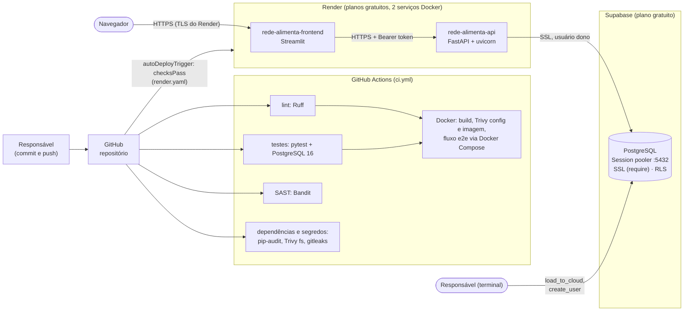
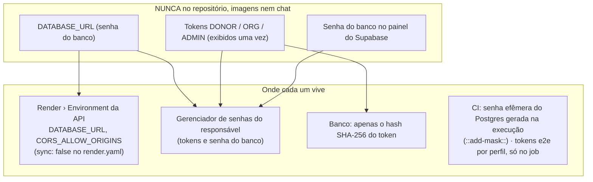
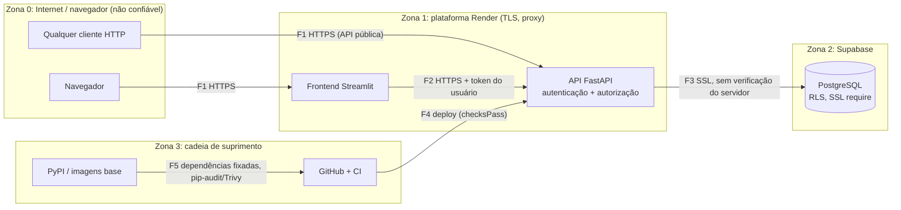

# Implantação — Rede Alimenta IA

> Conferido em `.github/workflows/ci.yml`, `render.yaml`, `docker/`, `docker-compose.yml`, `docs/DEPLOY.md`, `core/settings.py`, `core/hardening.py` e no relatório de estado do deploy do projeto (14/10/2026). O que depende de GitHub Actions, Docker, Render ou Supabase está marcado **"confirmado pelo CI"** ou **"não verificado neste ambiente"**: o ambiente em que esta documentação foi escrita não tem Docker, GitHub nem nuvem.

## 1. Pipeline e hospedagem

| Etapa | O que roda | Situação |
|---|---|---|
| Lint, testes, Bandit, pip-audit, Trivy, gitleaks, Docker e2e | `ci.yml` (ações fixadas por SHA, `permissions: contents: read`) | Execução no GitHub **confirmada pelo CI** (informada pelo responsável; não verificada aqui) |
| Publicação | Render lê `render.yaml` (Blueprint); `autoDeployTrigger: checksPass` | URLs públicas informadas pelo responsável (14/10/2026); **não verificado neste ambiente** |
| Banco | Supabase (projeto `rede-alimenta`, região informada: Virginia/EUA), carga por `scripts/load_to_cloud.py --confirm-cloud` | Informado pelo responsável; RLS conferido pelo passo 4 do `docs/DEPLOY.md` (**não verificado neste ambiente**) |
| Hibernação | Render gratuito hiberna após ~15 min sem uso (cerca de 1 min para acordar); Supabase gratuito pausa por inatividade | Risco aceito (STRIDE P3D-11) |

## 2. Onde ficam os segredos

O `render.yaml` contém **apenas** nomes de variáveis e valores não secretos; `.env.example` só documenta nomes; `.dockerignore` exclui `.env`, `data/` e testes das imagens; gitleaks (histórico e árvore) deu 0 achados nos relatórios `security/reports/depois/` (local) e roda também no CI.

## 3. Fronteiras de confiança

| Fronteira | Controle real | Limite conhecido |
|---|---|---|
| F1 Internet → API/frontend | TLS do Render; CORS restrito; cabeçalhos de segurança; `/docs` desligado; token Bearer; limite de **tentativas inválidas** por IP; **rate limit global** por token/IP | **API pública com token estático** (rotação manual); rate limit global **por instância e em memória**; sem WAF |
| F2 frontend → API | token do usuário na sessão do Streamlit (memória, nunca em disco); visibilidade por perfil aplicada **na API** | o frontend chama pelo servidor: o IP visto pela API tende a ser o do frontend |
| F3 API → banco | usuário dono; `sslmode=require` (criptografa); RLS + `REVOKE` de `anon`/`authenticated` | `require` **não verifica o servidor** (sem `verify-full`/CA); sem backup gerenciado |
| F4 GitHub → Render | deploy só depois dos checks (`checksPass`) | proteção de branch/revisão obrigatória são configurações do repositório (pendentes) |
| F5 dependências | versões fixadas; pip-audit, Trivy e gitleaks no CI | Trivy de imagem: JSONs antes/depois ainda não versionados em `security/reports/ci/` |

## 4. Execução local (alternativa à nuvem)

`docker compose up` sobe `postgres` (sem porta publicada), `migrate`, `api` e `frontend` em `127.0.0.1`, com `cap_drop: ALL` e `no-new-privileges`. O Compose **não** foi executado no ambiente em que esta documentação foi escrita (sem Docker); a execução ponta a ponta é confirmada pelo CI. Passo a passo: `docs/REPRODUCIBILITY.md`.

## 5. Validação dos diagramas Mermaid

Os **8 diagramas** deste diretório (`architecture.md` ×1, `data-flow.md` ×4, `deployment.md` ×3) foram **renderizados sem erro** nesta sessão com `@mermaid-js/mermaid-cli` 11.4.2 (Chromium headless), um a um. O primeiro teste achou um erro de sintaxe (ponto e vírgula dentro de mensagem do diagrama de sequência), corrigido e renderizado de novo. Renderizadores diferentes (GitHub, mermaid.live) podem usar outra versão do Mermaid; se algum bloco não aparecer, cole-o em <https://mermaid.live>. Os SVGs gerados não foram versionados.
